# Hệ thống Demo Phát hiện Hành vi Bất thường trong Siêu thị dựa trên Khung xương Người & Cảnh báo IoT Thời gian thực (Shopformer + PoseLift)

> **Lưu ý Đạo đức & Quyền riêng tư**:
> Hệ thống này là **bản demo học thuật** phục vụ đồ án môn học. Hệ thống **chỉ phát CẢNH BÁO "hành vi bất thường"** dựa trên chuỗi khung xương người (17 khớp xương COCO) để nhân viên vận hành xem xét:
> - **Không** tự động kết luận một người là "ăn trộm".
> - **Không** sử dụng nhận diện khuôn mặt hay đặc trưng sinh trắc học định danh.
> - **Không** lưu trữ video thô dài hạn (chỉ trích xuất khung xương và lưu đoạn clip ngắn ~5 giây quanh thời điểm phát sinh cảnh báo để người duyệt kiểm chứng).

---

## 1. Kiến trúc Hệ thống

Hệ thống kết hợp mô hình học sâu không giám sát trên đồ thị – chuỗi thời gian (**Shopformer**: *ST-GCN Autoencoder Tokenizer + Transformer Encoder-Decoder*) với luồng truyền thông IoT (**MQTT Mosquitto + FastAPI Web Dashboard + SQLite**).

```mermaid
flowchart LR
    subgraph Edge["Luồng Suy luận Thời gian thực (src/main.py)"]
        S1["1. VideoSource\n(15 FPS)"] --> S2["2. YOLOv8-pose\n(17 khớp COCO)"]
        S2 --> S3["3. ByteTrack\n(Gán Track ID)"]
        S3 --> S4["4. PoseBuffer\n(Cửa sổ trượt 12 khung/ID)"]
        S4 --> S5["5. PosePreprocessor\n(Nội suy, Làm mượt 8 khung,\nChuẩn hóa Shopformer 17->18)"]
        S5 --> S6["6. ShopformerScorer\n(GCAE Tokenizer + Transformer\n-> Điểm bất thường MSE)"]
        S6 --> S7["7. AlertManager\n(Làm mượt điểm, K=3 liên tiếp,\nCooldown 10s, Lưu clip 5s)"]
        S7 --> S8["8. MQTTPublisher\n(JSON Payload)"]
    end

    subgraph IoT["Hạ tầng IoT & Giám sát (docker-compose.yml)"]
        B[("Mosquitto Broker\nstore/{store_id}/cam/{cam_id}/alert")]
        D["FastAPI Dashboard\n(MQTT Subscriber + Web UI)"]
        DB[("SQLite (data/events.db)\nNhãn: Xác nhận / Bỏ qua")]
    end

    S8 -- "MQTT QoS 1" --> B
    B -- "Subscribe" --> D
    D <--> DB
```



### Cấu trúc Thư mục
```text
Shopformer/
├── configs/
│   ├── default.yaml          # Cấu hình tập trung toàn hệ thống (không hard-code đường dẫn)
│   └── mosquitto.conf        # Cấu hình Mosquitto MQTT Broker
├── checkpoints/
│   ├── gcae_best.pt          # Trọng số Giai đoạn 1 (ST-GCN Graph Autoencoder Tokenizer)
│   ├── shopformer_best.pt    # Trọng số Giai đoạn 2 (Transformer Encoder-Decoder)
│   ├── eval_metrics.json     # Kết quả đo AUC-ROC, AUC-PR, EER trên tập test PoseLift
│   └── threshold.json        # Thống kê phân vị điểm bất thường trên tập bình thường
├── data/
│   ├── PoseLift/             # Bộ dữ liệu PoseLift (pose/train, pose/test, gt/test_frame_mask)
│   ├── clips/                # Các đoạn video ngắn (~5 giây) lưu tự động quanh sự kiện
│   └── events.db             # Cơ sở dữ liệu SQLite lưu sự kiện & nhãn phản hồi của người duyệt
├── third_party/
│   ├── Shopformer/           # Mã nguồn gốc của bài báo Shopformer (GCAE + Transformer)
│   └── PoseLift/             # Repo PoseLift kèm 3 video mẫu hành vi bất thường
├── src/
│   ├── source.py             # Bước 1: Đọc camera/video, hạ tốc độ khung hình về 15 FPS
│   ├── pose_track.py         # Bước 2 & 3: YOLOv8-pose (COCO17) + ByteTrack theo dõi đa đối tượng
│   ├── buffer.py             # Bước 4: Bộ đệm cửa sổ trượt 12 khung hình theo từng Track ID
│   ├── preprocess.py         # Bước 5: Nội suy tuyến tính, làm mượt 8 khung, chuẩn hóa COCO18
│   ├── scorer.py             # Bước 6: Bọc mô hình Shopformer, trả sai số tái tạo MSE
│   ├── alerting.py           # Bước 7: Làm mượt điểm, kiểm tra K=3 cửa sổ liên tiếp, cooldown, lưu clip
│   ├── mqtt_pub.py           # Bước 8: Phát bản tin JSON cảnh báo qua MQTT
│   ├── main.py               # Kết nối toàn bộ luồng Bước 1–8
│   └── dashboard/            # Subscriber MQTT + Giao diện Web FastAPI + SQLite
│       ├── app.py
│       ├── db.py
│       └── templates/index.html
├── scripts/
│   ├── download_poselift.py  # Tải bộ dữ liệu PoseLift từ Google Drive chính thức
│   ├── extract_poses.py      # Trích xuất khung xương từ video (dùng chung code Bước 1–5)
│   ├── train_shopformer.py   # Huấn luyện 2 giai đoạn của Shopformer trên chuỗi pose bình thường
│   ├── evaluate.py           # Đánh giá AUC-ROC, AUC-PR, EER trên tập test PoseLift
│   └── calibrate_threshold.py# Hiệu chỉnh ngưỡng theo phân vị (mặc định P99) trên tập bình thường
├── tests/                    # Bộ kiểm thử đơn vị & tích hợp (pytest) cho từng giai đoạn
│   ├── test_stage_b.py
│   ├── test_stage_c.py
│   ├── test_stage_d.py
│   └── test_stage_e.py
├── Dockerfile.dashboard
├── docker-compose.yml
└── README.md
```

---

## 2. Dữ liệu Sử dụng & Tiền xử lý

1. **Bộ dữ liệu PoseLift** (*WACV 2025 / CVPRW 2025*):
   - **Tập huấn luyện (`data/PoseLift/pose/train`)**: `104` file JSON chứa các chuỗi khung xương hoàn toàn **bình thường** trong siêu thị (`12,268` cửa sổ 12 khung hình với `stride=6`).
   - **Tập kiểm thử (`data/PoseLift/pose/test`)**: `47` file JSON chứa cả hành vi bình thường và bất thường (`3,607` cửa sổ với `stride=1`), đi kèm `47` file nhãn mặt nạ từng khung hình (`0` = bình thường, `1` = bất thường) tại `data/PoseLift/gt/test_frame_mask`.
2. **Đồng bộ Chuẩn hóa giữa Huấn luyện & Suy luận**:
   - Nội suy tuyến tính các khung hình hoặc khớp xương bị khuyết (cho phép khuyết tối đa 2 khung trong cửa sổ 12 khung).
   - Làm mượt tọa độ `(X, Y)` theo thời gian bằng cửa sổ trượt 8 khung hình (`uniform_filter1d(size=8)`).
   - Chuyển đổi 17 khớp `COCO17` sang 18 khớp `OpenPose COCO18` (thêm khớp cổ `neck = 0.5 * (left_shoulder + right_shoulder)`).
   - Chuẩn hóa tọa độ theo đúng công thức của Shopformer: chia cho độ phân giải khung hình `[W, H]`, trừ tâm trung bình của cửa sổ và chia cho độ lệch chuẩn theo trục dọc `std(Y)`.

---

## 3. Kết quả Thực nghiệm trên Tập Test PoseLift

Chạy lệnh `.\.venv\Scripts\python.exe scripts/evaluate.py` trên toàn bộ 47 video test của PoseLift với bộ trọng số tại `checkpoints/`:

| Chỉ số đánh giá (Metric) | Kết quả đo thực tế (`evaluate.py`) | Kết quả trong bài báo Shopformer (CVPRW 2025) | Ghi chú |
| :--- | :---: | :---: | :--- |
| **AUC-ROC (%)** $\uparrow$ | **74.33** | 69.15 | Diện tích dưới đường cong ROC |
| **AUC-PR (%)** $\uparrow$ | **49.13** | 44.49 | Diện tích dưới đường cong Precision-Recall |
| **EER** $\downarrow$ | **0.3315** | 0.38 | Tỷ lệ lỗi cân bằng (Equal Error Rate — thấp hơn là tốt hơn) |
| **EER Threshold** | `0.223634` | — | Ngưỡng MSE tại điểm EER trên tập test |

> **Giải thích kỹ thuật về kết quả**: Trong mã nguồn gốc của repo `PoseLift`/`Shopformer`, hàm đọc khung hình `pose_utils.py` sắp xếp khóa số thứ tự frame dưới dạng chuỗi ký tự (`sorted(single_person.keys())` khiến `'10'` đứng trước `'7'`, làm xáo trộn thứ tự thời gian) và thứ tự cột trong JSON gốc là `[Y, X, C]`. Khi chúng ta sửa lại sắp xếp số nguyên `key=lambda x: int(float(x))` và đồng bộ thứ tự `[X, Y, C]`, tính liên tục thời gian của cửa sổ 12 khung hình được bảo toàn đúng bản chất vật lý, giúp các chỉ số `AUC-ROC`, `AUC-PR` và `EER` đều cải thiện so với số liệu công bố ban đầu.

### Phân bố Điểm trên Tập Bình thường (`scripts/calibrate_threshold.py`)
- Trên `12,268` cửa sổ bình thường của `PoseLift/pose/train`:
  - `P50 (Trung vị)`: `0.2176`
  - `P90`: `1.1676`
  - `P95`: `4.0879`
  - `P99`: `36.7493` (do ~1% chuỗi khung xương thô trong tập train bị che khuất gần hết cơ thể khiến `std(Y)` xấp xỉ `0`, làm biên độ sau chuẩn hóa tăng vọt).
- Trên các chuỗi khung xương người đi bộ/đứng bình thường trích xuất qua pipeline YOLOv8-pose + làm mượt 8 khung (`data/extracted_samples/demo_rgb_people.mp4`), điểm MSE nằm trong khoảng `0.1700 – 0.2576`. Do đó, ngưỡng vận hành mặc định cho luồng cảnh báo thời gian thực trong [`configs/default.yaml`](file:///e:/Shopformer/configs/default.yaml) được đặt là `default_threshold: 0.30` (nằm trên mức dao động bình thường `0.2576`, đồng thời bắt nhạy các chuỗi hành vi bất thường có điểm MSE từ `0.42 – 1.91`).

---

## 4. Giới hạn của Hệ thống (Báo cáo Trung thực)

1. **Độ chính xác ở mức khiêm tốn (`AUC-PR = 49.13%`, `EER = 0.3315`)**:
   - Mô hình chỉ dựa trên tọa độ 2D của các khớp xương mà **không nhìn thấy vật thể/hàng hóa** trên tay khách hàng. Vì vậy, các động tác bình thường nhưng ít gặp (như cúi sâu buộc dây giày, cho tay vào túi áo khoác lấy điện thoại, vươn người lấy hàng trên kệ cao) cũng tạo ra sai số tái tạo MSE cao và có thể gây báo động nhầm.
2. **Quy mô bộ dữ liệu nhỏ**:
   - Bộ dữ liệu PoseLift chỉ gồm 151 đoạn dữ liệu khung xương từ 6 góc camera siêu thị. Mô hình chưa được học trên đa dạng độ tuổi, trang phục hoặc tốc độ di chuyển khác nhau.
3. **Nhạy cảm với sự thay đổi góc camera và hiện tượng che khuất (Occlusion)**:
   - Trong siêu thị thực tế, kệ hàng thường che khuất phần chân của khách hàng. Khi các khớp chân có độ tin cậy bằng `0` hoặc bị ước lượng sai, tâm khung xương và độ lệch chuẩn chiều cao `std(Y)` bị biến dạng, dễ dẫn đến điểm MSE tăng đột biến.
   - Khi lắp đặt camera ở góc nhìn mới (ví dụ góc nhìn từ đỉnh đầu xuống hoặc góc thấp), cần thu thập lại các clip đi lại bình thường tại góc máy đó và chạy lại `scripts/calibrate_threshold.py`.
4. **Phụ thuộc vào chất lượng theo dõi đối tượng (ByteTrack)**:
   - Nếu hai người đi cắt ngang nhau gây đổi ID (`ID switch`), cửa sổ trượt 12 khung hình sẽ ghép khung xương của hai người khác nhau, gây nhảy điểm bất thường tại thời điểm giao cắt.

---

## 5. Hướng dẫn Cài đặt & Sử dụng

### 5.1. Môi trường Python
Dự án sử dụng Python 3.11 trong môi trường ảo `.venv`:
```powershell
# Kiểm tra toàn bộ 16 bài test đơn vị & tích hợp (Stages B, C, D, E)
.\.venv\Scripts\python.exe -m pytest tests/ -v
```

### 5.2. Các Lệnh Chạy Đánh giá & Tiện ích
```powershell
# 1. Đánh giá AUC-ROC, AUC-PR, EER trên tập test PoseLift
.\.venv\Scripts\python.exe scripts/evaluate.py

# 2. Hiệu chỉnh ngưỡng từ tập bình thường (mặc định phân vị 99)
.\.venv\Scripts\python.exe scripts/calibrate_threshold.py --percentile 99

# 3. Trích xuất khung xương từ video bất kỳ ra chuẩn JSON/PKL của PoseLift
.\.venv\Scripts\python.exe scripts/extract_poses.py --input data/extracted_samples/demo_rgb_people.mp4 --output-dir data/extracted_samples --save-pkl
```

---

## 6. Kịch bản Demo Ngắn (5 Phút Bảo vệ Đồ án)

### Bước 1: Chứng minh Kết quả Đánh giá Học thuật trên Tập Test PoseLift
Chạy lệnh đánh giá để in bảng so sánh `AUC-ROC`, `AUC-PR`, `EER` với bài báo gốc:
```powershell
.\.venv\Scripts\python.exe scripts/evaluate.py
```

### Bước 2: Khởi động Broker MQTT & Giao diện Web Dashboard
**Cách 1 — Chạy bằng Docker Compose (Khuyến nghị khi đã bật Docker Desktop):**
```powershell
docker compose up -d --build
```
*(Lệnh này khởi động container `shopformer-mosquitto` ở cổng `1883` và `shopformer-dashboard` ở cổng `8000`).*

**Cách 2 — Chạy trực tiếp Dashboard trên máy host (nếu không bật Docker):**
```powershell
.\.venv\Scripts\python.exe -m shoplift_iot.dashboard.app --port 8000
```
Mở trình duyệt truy cập: **`http://localhost:8000`**

### Bước 3: Chạy Suy luận trên Video Bình thường (Không phát cảnh báo giả)
Mở một cửa sổ terminal thứ hai và chạy trên video người đứng/di chuyển bình thường:
```powershell
.\.venv\Scripts\python.exe -m shoplift_iot.main --source "data/extracted_samples/demo_rgb_people.mp4"
```
- **Quan sát**: Điểm MSE chỉ dao động quanh `0.17 – 0.26` (thấp hơn ngưỡng `0.30`), không vượt ngưỡng trong 3 cửa sổ liên tiếp nên `Total anomaly alerts emitted: 0`.

### Bước 4: Chạy Suy luận trên Video Hành vi Bất thường (Phát cảnh báo MQTT + Lưu Clip 5s)
Chạy trên video mẫu hành vi giấu hàng của PoseLift:
```powershell
.\.venv\Scripts\python.exe -m shoplift_iot.main --source "third_party/PoseLift/Samples/Hiding an item in their pants.mp4" --max-frames 45
```
- **Quan sát trên Terminal**:
  - Khi điểm MSE đã làm mượt vượt ngưỡng `0.30` trong **3 cửa sổ liên tiếp** (`K=3`), hệ thống in ra dòng `[ALERT]`, lưu đoạn clip 5 giây có vẽ khung xương + điểm số vào `data/clips/evt_*.mp4`, và gửi bản tin JSON qua MQTT topic `store/store_01/cam/cam_01/alert`.
  - Các khung hình tiếp theo của cùng `track_id` trong vòng 10 giây sẽ được chặn bởi cơ chế **cooldown** để tránh báo lặp.

### Bước 5: Xem lại Clip & Gán Nhãn trên Web Dashboard (`http://localhost:8000`)
- Trên trang web `http://localhost:8000`, thẻ sự kiện mới tự động xuất hiện ở đầu danh sách (cập nhật mỗi 2.5 giây).
- Người vận hành xem lại đoạn clip 5 giây phát trực tiếp trên thẻ sự kiện và bấm một trong hai nút:
  - **"Xác nhận"** (`decision = "confirmed"`) nếu đúng là hành vi đáng ngờ cần kiểm tra.
  - **"Bỏ qua"** (`decision = "ignored"`) nếu là báo động nhầm.
- Lựa chọn này được lưu bền vững vào bảng `events` trong file SQLite `data/events.db` để làm nhãn phục vụ tinh chỉnh mô hình về sau.

