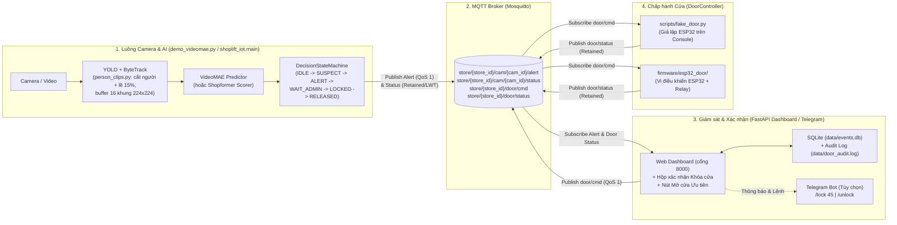

# Hệ thống Camera Phát hiện Hành vi Nghi Trộm, Cảnh báo Admin & Điều khiển Khóa Cửa An toàn (YOLO + ByteTrack + VideoMAE / Shopformer + MQTT + ESP32)

> **Lưu ý Đạo đức, Quyền riêng tư & Phạm vi Sử dụng**:
> Đây là **đồ án demo học thuật ở trường**, không sử dụng cho mục đích thương mại (tuân thủ giấy phép phi thương mại **CC BY-NC 4.0** của bộ dữ liệu PoseLift).
> - Hệ thống **chỉ phát CẢNH BÁO "hành vi nghi ngờ"** để nhân viên/admin xem xét video clip ngắn và tự quyết định.
> - **Không** tự động khóa cửa (`auto_lock: false`), **không** nhận diện khuôn mặt hay định danh cá nhân (chỉ dùng `track_id` tạm thời từ ByteTrack).

---

## 1. Kiến trúc Hệ thống & Luồng Hoạt động



---

## 2. Hợp đồng MQTT & 5 Ràng buộc An toàn Bắt buộc

### 2.1. Hợp đồng MQTT (Giữ nguyên tên Topic & Trường JSON)

| Topic | Payload JSON / Chuỗi | QoS / Retain | Mô tả |
| :--- | :--- | :---: | :--- |
| `store/{store_id}/cam/{cam_id}/alert` | `{"event_id", "ts", "cam_id", "track_id", "score", "threshold", "clip_path"}` | `QoS 1`, `retain=False` | Cảnh báo kèm đường dẫn clip khi vượt ngưỡng `K` cửa sổ liên tiếp |
| `store/{store_id}/cam/{cam_id}/status` | `"online"` \| `"offline"` | `QoS 1`, `retain=True` (Last Will) | Trạng thái kết nối của node camera |
| `store/{store_id}/door/cmd` | `{"action": "lock"\|"unlock", "reason", "event_id", "ttl_sec"}` | `QoS 1`, `retain=False` | Lệnh khóa/mở cửa do Admin phát từ Dashboard hoặc Telegram |
| `store/{store_id}/door/status` | `{"state": "locked"\|"unlocked", "ts", "event_id"}` | `QoS 1`, `retain=True` (Last Will) | Trạng thái thực tế của cửa do `DoorController` / `ESP32` báo về |

### 2.2. Năm Ràng buộc An toàn (Safety Constraints)

1. **Chỉ Admin mới được khóa cửa (`auto_lock = false`)**:
   - Trong [`configs/default.yaml`](file:///e:/Shopformer/configs/default.yaml), cờ `alerting.auto_lock` mặc định là `false`. Khi phát hiện nghi vấn, máy trạng thái dừng ở `WAIT_ADMIN` (hết `wait_admin_seconds = 30s` không có lệnh sẽ tự về `IDLE`).
   - Trên Dashboard, bấm **Khóa cửa** bắt buộc phải qua **Hộp xác nhận (`#lock-confirm-modal`)**. Trên Telegram, chỉ `TELEGRAM_CHAT_ID` của Admin mới được phép gửi lệnh `/lock`.
2. **Bắt buộc có thời hạn `ttl_sec` (mặc định 45 giây) & Ưu tiên Mở cửa (`unlock`)**:
   - Mọi lệnh `lock` đều có thời hạn `ttl_sec` (mặc định `45s`, tối đa `120s`). Hết thời hạn, `DoorController` và firmware ESP32 tự động mở khóa (`unlocked`) và báo lại `door/status`.
   - Nút **`🔓 Mở cửa ngay (Ưu tiên)`** luôn hiển thị nổi bật trên Dashboard; lệnh `unlock` luôn ghi đè và xóa bộ đếm khóa ngay lập tức ở mọi trạng thái.
3. **Fail-safe (An toàn khi sự cố)**:
   - Khi mất kết nối WiFi/MQTT, mất nguồn, hoặc xảy ra lỗi phần mềm/JSON không hợp lệ, `DoorController` và firmware ESP32 lập tức đưa cửa về trạng thái **`"unlocked"` (MỞ)** (kèm bản tin MQTT Last Will `"unlocked"`).
4. **Ghi nhận Nhật ký Kiểm toán (Audit Log)**:
   - Mọi lệnh cửa và chuyển đổi trạng thái đều được ghi vào [`data/door_audit.log`](file:///e:/Shopformer/configs/default.yaml#L97) (JSON Lines) và bảng `door_logs` trong SQLite (`data/events.db`) với đầy đủ: thời gian `ts`, người phát `actor`, `action`, `reason`, `event_id`, `ttl_sec`.
5. **Bảo vệ Quyền riêng tư**:
   - Không nhận diện khuôn mặt, không định danh người, chỉ sử dụng `track_id` tạm thời của ByteTrack trong phiên làm việc.

---

## 3. Cấu trúc Thư mục Dự án

```text
Shopformer/
├── configs/
│   ├── default.yaml                  # Cấu hình tập trung (paths, person_clips, alerting, door, mqtt, dashboard)
│   └── mosquitto.conf                # Cấu hình Mosquitto MQTT Broker
├── src/shoplift_iot/
│   ├── contracts.py                  # Hợp đồng dữ liệu: AlertEvent, DoorCommand, DoorStatus
│   ├── config.py                     # Đọc cấu hình YAML + biến môi trường
│   ├── vision/
│   │   ├── person_clips.py           # GD2: YOLO + ByteTrack cắt vùng người (+15% lề), xuất 16 khung 224x224
│   │   ├── pose_track.py             # YOLOv8-pose + ByteTrack cho nhánh khung xương
│   │   └── preprocess.py             # Chuẩn hóa chuỗi khung xương COCO17 -> COCO18
│   ├── alerting/
│   │   ├── state_machine.py          # GD4: Máy trạng thái IDLE->SUSPECT->ALERT->WAIT_ADMIN->LOCKED->RELEASED
│   │   └── alerting.py               # Quản lý cảnh báo và trích xuất clip sự kiện
│   ├── actuators/
│   │   └── door_controller.py        # GD5: Bộ điều khiển cửa fail-safe, đếm ngược TTL, ghi audit log
│   ├── messaging/
│   │   ├── mqtt_pub.py               # Publish cảnh báo MQTT QoS 1 & trạng thái camera (retained + Last Will)
│   │   └── telegram_bot.py           # GD6: Bot Telegram tùy chọn (gửi cảnh báo, nhận lệnh /lock & /unlock)
│   ├── dashboard/
│   │   ├── app.py                    # GD6: FastAPI server + MQTT bridge (alert, door/status, door/cmd)
│   │   ├── db.py                     # SQLite lưu bảng events và bảng door_logs
│   │   └── templates/index.html      # Giao diện Web: danh sách clip, trạng thái cửa, hộp xác nhận khóa cửa
│   └── main.py                       # Pipeline suy luận đa luồng
├── scripts/
│   ├── extract_person_clips.py       # GD2: Cắt clip từng người offline từ video quay sẵn để tạo tập train VideoMAE
│   ├── fake_door.py                  # GD5: Script giả lập cửa ESP32 chạy trên terminal
│   ├── evaluate.py                   # Đánh giá AUC-ROC, AUC-PR, EER trên tập PoseLift
│   └── calibrate_threshold.py        # Hiệu chỉnh ngưỡng cảnh báo
├── firmware/esp32_door/
│   ├── esp32_door.ino                # GD5: Firmware Arduino/PlatformIO cho ESP32 thật (fail-safe + TTL)
│   └── platformio.ini                # Cấu hình build PlatformIO
├── notebooks/
│   ├── train_videomae.ipynb          # Notebook fine-tune VideoMAE (2 lớp: normal / shoplifting)
│   └── train_shopformer.ipynb        # Notebook huấn luyện Shopformer trên PoseLift (Colab / Kaggle)
├── videomae_lite.py                  # Predictor VideoMAE đọc clip 16 khung hình 224x224
├── demo_videomae.py                  # GD4: Vòng lặp thời gian thực nối person_clips + VideoMAE + DecisionStateMachine + MQTT
├── tests/                            # Bộ kiểm thử tự động pytest (86 bài test)
│   ├── test_person_clips.py          # Test GD2 (bbox +15% lề, buffer 16 khung, cắt clip offline)
│   ├── test_state_machine_and_demo.py# Test GD4 (chuyển trạng thái, K liên tiếp, cooldown, timeout WAIT_ADMIN, ưu tiên unlock)
│   ├── test_door_controller.py       # Test GD5 (DoorController, TTL tự mở, fail-safe mất MQTT, audit log, firmware)
│   ├── test_alerting_and_dashboard.py# Test GD6 (Dashboard API, hộp xác nhận khóa cửa, Telegram bot, hợp đồng JSON)
│   ├── test_capture_and_vision.py
│   ├── test_model_and_eval.py
│   └── test_scorer_and_bundle.py
├── docker/
│   ├── Dockerfile.dashboard          # Container image cho Dashboard và fake_door
│   └── Dockerfile.pipeline           # Container image cho Pipeline suy luận
└── docker-compose.yml                # GD7: mosquitto + dashboard + fake_door + pipeline
```

---

## 4. Hướng dẫn Chạy Demo Từng Bước

### Cách 1: Chạy trọn bộ bằng Docker Compose (`mosquitto + dashboard + fake_door + pipeline`)

```powershell
# Khởi động cả 4 dịch vụ (Mosquitto Broker, Web Dashboard, Fake Door ESP32, và Pipeline)
docker compose up --build
```
- **Dashboard Web**: Mở trình duyệt tại **`http://localhost:8000`**
- **Quan sát trạng thái cửa giả lập**: Xem log của container `shopformer-fake-door` (`docker logs -f shopformer-fake-door`).

---

### Cách 2: Chạy Từng Thành phần trên Máy Local (Phục vụ Demo & Giải thích từng bước khi Bảo vệ)

#### Bước 1: Kiểm tra toàn bộ bộ test tự động (`pytest`)
```powershell
.\.venv\Scripts\python.exe -m pytest -q
```

#### Bước 2: Khởi động MQTT Broker (nếu chưa bật Mosquitto) & Web Dashboard
Mở **Terminal 1** — chạy Web Dashboard:
```powershell
# Tùy chọn: đặt biến môi trường nếu muốn bật thêm Bot Telegram
# $env:TELEGRAM_BOT_TOKEN="123456:ABCDEF..."
# $env:TELEGRAM_CHAT_ID="987654321"

.\.venv\Scripts\python.exe -m shoplift_iot.dashboard.app --config configs/default.yaml --port 8000
```
Mở trình duyệt truy cập **`http://localhost:8000`**.

#### Bước 3: Khởi động Bộ Giả lập Cửa ESP32 (`fake_door.py`)
Mở **Terminal 2** — chạy script giả lập cửa ra vào:
```powershell
.\.venv\Scripts\python.exe scripts/fake_door.py --config configs/default.yaml
```
- Terminal sẽ hiển thị trạng thái ban đầu: `🔓 [DOOR UNLOCKED (MỞ)] | state=unlocked` (Fail-safe mặc định luôn mở).

#### Bước 4: Chạy Luồng Phát hiện Nghi Trộm & Phát Cảnh báo MQTT
Mở **Terminal 3** — chọn 1 trong 2 luồng suy luận:

- **Luồng A — VideoMAE + YOLO + ByteTrack (`demo_videomae.py`)**:
  ```powershell
  # Cắt clip 16 khung theo từng track_id (lề 15%) -> chấm điểm VideoMAE -> qua DecisionStateMachine -> gửi MQTT
  .\.venv\Scripts\python.exe demo_videomae.py --ckpt models/videomae_shoplift --source 0 --broker localhost --port 1883
  ```
  *(Nếu muốn cắt clip từ video quay sẵn để làm dữ liệu huấn luyện cho `notebooks/train_videomae.ipynb`, dùng lệnh chung code)*:
  ```powershell
  .\.venv\Scripts\python.exe scripts/extract_person_clips.py --input data/extracted_samples/demo_rgb_people.mp4 --output-dir data/person_clips/normal
  ```

- **Luồng B — Shopformer trên video mẫu PoseLift (`shoplift_iot.main`)**:
  ```powershell
  .\.venv\Scripts\python.exe -m shoplift_iot.main --source "third_party/PoseLift/Samples/Hiding an item in their pants.mp4" --max-frames 45
  ```

#### Bước 5: Admin Xác nhận Cảnh báo & Khóa/Mở Cửa trên Dashboard (`http://localhost:8000`)
1. Khi có cảnh báo vượt ngưỡng `K=3` cửa sổ liên tiếp, thẻ sự kiện kèm clip xuất hiện trên `http://localhost:8000`.
2. Admin xem clip, nếu cần khóa cửa tạm thời thì bấm nút **`🔒 Khóa cửa (45s)`** trên thẻ sự kiện (hoặc nút **`🔒 Khóa cửa (Có xác nhận)`** ở thanh trạng thái cửa).
3. **Hộp xác nhận Khóa cửa** hiện lên: Admin kiểm tra `event_id`, thời hạn `ttl_sec` (mặc định `45` giây), lý do và bấm **`Xác nhận Khóa cửa`**.
4. Hệ thống phát bản tin `store/store_01/door/cmd` (`QoS 1`) và ghi vào `data/door_audit.log` + bảng `door_logs`.
5. Cửa chuyển sang `🔒 CỬA ĐANG KHÓA (LOCKED)` và tự động mở lại sau `45` giây, hoặc mở ngay lập tức khi Admin bấm **`🔓 Mở cửa ngay (Ưu tiên)`**.

---

## 5. Báo cáo Trung thực về Những gì Đã & Chưa Kiểm thử được

1. **Phần cứng ESP32 & Relay vật lý**:
   - Đã viết đầy đủ mã nguồn firmware tại [`firmware/esp32_door/esp32_door.ino`](file:///e:/Shopformer/firmware/esp32_door/esp32_door.ino) và [`firmware/esp32_door/platformio.ini`](file:///e:/Shopformer/firmware/esp32_door/platformio.ini) tuân thủ đúng hợp đồng MQTT, cơ chế tự mở khi hết `ttl_sec` và fail-safe ngắt relay khi rớt WiFi/MQTT.
   - **Chưa kiểm thử trên mạch ESP32 + khóa từ thật** trong môi trường hiện tại; toàn bộ logic điều khiển cửa, đếm ngược TTL, ưu tiên lệnh `unlock` và fail-safe đã được kiểm thử tự động qua `DoorController`, `scripts/fake_door.py` và mock MQTT broker trong [`tests/test_door_controller.py`](file:///e:/Shopformer/tests/test_door_controller.py).
2. **Huấn luyện VideoMAE & GPU**:
   - Môi trường chạy kiểm thử hiện tại dùng CPU; việc fine-tune `MCG-NJU/videomae-base` trong [`notebooks/train_videomae.ipynb`](file:///e:/Shopformer/notebooks/train_videomae.ipynb) hoặc huấn luyện Shopformer trong [`notebooks/train_shopformer.ipynb`](file:///e:/Shopformer/notebooks/train_shopformer.ipynb) được thiết kế để chạy trên Google Colab / Kaggle có GPU T4.
3. **Độ chính xác nhận diện hành vi trong thực tế**:
   - Trên tập test PoseLift, nhánh khung xương đạt `AUC-ROC = 74.33%`, `AUC-PR = 49.13%`, `EER = 0.3315`. Các động tác cúi người sâu, chỉnh trang phục hoặc bị kệ hàng che khuất vẫn có thể gây cảnh báo giả, do đó **ràng buộc `auto_lock = false` (bắt buộc con người xem clip và bấm xác nhận)** là chốt chặn an toàn cốt lõi của hệ thống.
